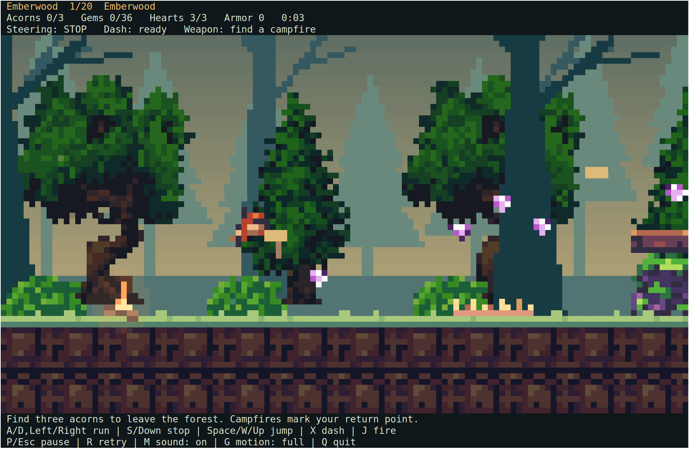

# Emberwood Terminal

A fox, twenty forest trails, and six stubborn guardians — played entirely in your terminal.

This Kotlin/JVM edition brings the existing [Emberwood](https://github.com/samsaw123456/emberwood-kt) campaign to [tui4j](https://github.com/WilliamAGH/tui4j). The original pixel artwork becomes colored ANSI half-blocks. The original level geometry, 60 Hz physics, moving platforms, mushrooms, crumbling bridges, collectibles, weapons, armor, and guardian fights remain game systems, not decorative terminal animations.



Actual installed game in a 120×40 XTerm window.

## Install and play

On **Linux or macOS**, paste this into a terminal:

```sh
curl -fsSL https://github.com/samsaw123456/emberwood-tui/releases/download/v1.0.1/install.sh | bash
```

The installer checks prerequisites, verifies the release checksum, downloads a checksum-pinned private Java 25 if needed, and installs for your user. On Linux it automatically installs missing system utilities, certificates, font/audio libraries and a desktop terminal through your package manager; only missing system packages require administrator access. Your system Java stays unchanged. Open **Emberwood Terminal** in your application launcher, or run:

```sh
~/.local/bin/emberwood-tui
```

If `curl` or HTTPS certificates are missing, [download install.sh](https://github.com/samsaw123456/emberwood-tui/releases/download/v1.0.1/install.sh) in your browser and run `bash ~/Downloads/install.sh`. The downloaded installer can prepare those dependencies itself. Stock macOS already supplies its system tools and Terminal.app.

The Linux launcher uses your desktop's terminal application. macOS gets an application in `~/Applications` that opens Terminal.app. Both use Emberwood's original fox artwork. Installation needs internet; installed play works offline. See [installation details, overrides, updates and removal](docs/PACKAGING.md).

The application menu and pinned taskbar are separate. **From this source checkout**, `./install.sh --pin` also pins Emberwood Terminal to the current GNOME dock, preserving other favorites and their order. Repeating it does not add duplicates. The published v1.0.1 installer registers the application menu only; use **Add to Favorites** in GNOME or drag the installed macOS application to the Dock.

Use a UTF-8 color terminal and a monospace font that includes `▀`. **100×36 cells or larger** is recommended; 80×28 is the minimum. Enlarge the terminal or reduce its font size for more detailed artwork. Truecolor preserves the original RGB palette; Apple Terminal automatically uses a 256-color approximation. Set `EMBERWOOD_TUI_COLOR=256` or `EMBERWOOD_TUI_COLOR=truecolor` to override detection. Desktop launches request 120×40 cells where the terminal supports resizing. No graphics protocol, browser, GPU, or Godot installation is required.

## How to play

Collect **three acorns** to open each exit. Gather gems and find a hidden firefly on every trail if you want the extra challenge. Campfires mark your return point and award equipment. Touching a new camp recharges armor. When you fall or lose your hearts, you return to camp with collected items intact.

Every third trail has a guardian. Dodge its marked landing, jump its ground waves, then strike its **gold cap while resting**. Three hits open the path. Six animals have different attack timings. The final two trails bring you home.

| Action | Physical keys |
| --- | --- |
| Start running left | A or Left arrow |
| Start running right | D or Right arrow |
| Stop running | S or Down arrow |
| Jump; press again to double-jump | Space, W or Up arrow |
| Dash in the facing direction | X |
| Fire equipped weapon | J |
| Return to the current camp | R |
| Pause / resume | P or Escape |
| Pause safely without suspending the terminal | Ctrl+Z |
| Choose equipment while paused | Up, Down or Tab |
| Equip / remove the selected item | Enter while paused |
| Start / next trail / play again | Enter |
| Toggle sound | M |
| Toggle reduced motion (particles, snow, camera easing) | G |
| Quit | Q or Ctrl+C |

**Tap to steer; tap to stop.** Ordinary ANSI terminals send presses, not releases. Movement intentionally continues after releasing A/D or an arrow. You can jump, dash and fire while running. Jump presses use a 0.35-second hold pulse; keyboard auto-repeat can issue additional actions. Shift alone cannot be detected by ordinary terminals, so dash uses X. Letter commands are lowercase.

Pause, death, level changes, and reported focus loss clear steering. Focus-loss detection depends on your terminal; pause before switching away if it does not report focus. Shrinking below the minimum size pauses play; enlarge it and press P to resume. Mouse, touch, controller, key remapping, and variable-height physical key-release jumping are not implemented.

Five weapons and eight armor sets unlock across the campaign. Pause to inspect every item, its unlock location, and its effect. Armor damage survives swapping equipment. Removed chests, bonus leaf shields, and the old companion are intentionally absent.

## Useful entry points

```sh
./emberwood-tui                  # build if needed, then play
./emberwood-tui --build          # prepare without opening the game
./emberwood-tui --offline        # run the existing build, with no downloads
./emberwood-tui --practice 12    # start any trail, 1–20, with earlier equipment
./emberwood-tui --help
./emberwood-tui --version
```

Practice runs do not replace a full-campaign best time. Current-run progress and checkpoints are in memory; sound, motion preferences, and the best completed campaign time persist in `~/.config/emberwood-tui` on Linux (`XDG_CONFIG_HOME` supported), or `~/Library/Application Support/Emberwood Terminal` on macOS. They are separate from the app installation and desktop game. Quitting ends the current run. Zed includes **Play Emberwood Terminal** and **Build Emberwood Terminal** tasks; Play opens the integrated terminal in the center pane with enough room for the game.

## Build and verify

The checked-in wrapper uses **Gradle 9.9.1**, **Kotlin 2.4.21**, **tui4j 0.3.5**, and **JVM 25**. Bootstrap pins **Temurin 25.0.5+8** for Linux/macOS, x86-64/ARM64. These stable versions were rechecked on November 15, 2026. The [quality review](docs/QUALITY_REVIEW.md) records dependency compatibility, recent-session guidance, and the follow-up checks.

```sh
export JAVA_HOME="$(tools/bootstrap.sh)"
./gradlew check fatJar
python3 -m venv .venv
.venv/bin/pip install -r tools/audit-requirements.txt
.venv/bin/python tools/ansi_audit.py
```

`check` runs ktlint and the simulation, terminal-input, settings, route and artwork tests. The ANSI audit launches actual tui4j processes in pseudoterminals, sends physical-key byte sequences, decodes the returned terminal screen, and retains before/after captures. Test-only fixtures are outside the release JAR. [Control coverage](docs/CONTROLS.md), [verification results and limits](docs/VERIFICATION.md), and the [game checklist](docs/GAME_CHECKLIST.md) distinguish terminal evidence from simulation evidence.

## Inside the port

- `Simulation.kt`, `Model.kt`, `Equipment.kt`, `Levels.kt`: original rules and exported campaign geometry.
- `Main.kt`, `TerminalInput.kt`: tui4j model, terminal controls, state transitions, readable HUD and equipment menus.
- `TerminalRenderer.kt`: ANSI half-block encoder for the original art renderer; no terminal screenshots are faked with static art.
- `src/main/resources/assets`: original artwork, icon, fonts, source catalog and licenses.
- `install.sh`, `tools/`: private runtime bootstrap, packaging and reproducible audits.

The port descends from the [Phippy Gaming Workshop](https://github.com/Tingsters/Phippy-Gaming-Workshop), through the local Godot and Kotlin Emberwood editions. [Source audit](docs/SOURCE_AUDIT.md) records the migration and prior testing lessons. Code is Apache-2.0; artwork and dependencies retain their own licenses. See [credits](THIRD_PARTY.md).
