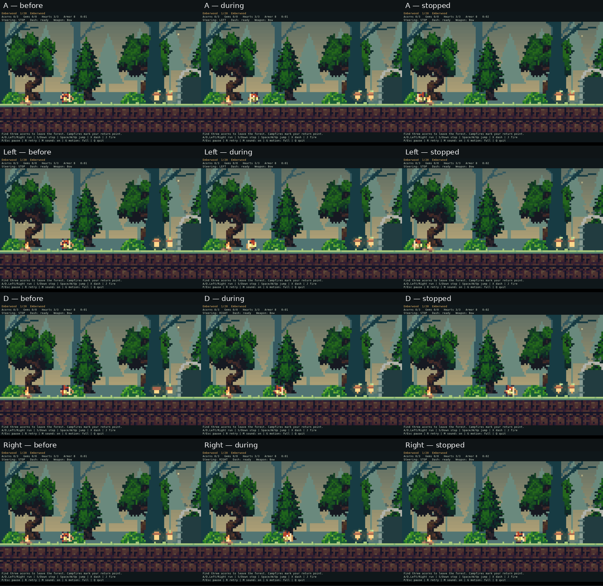

# Control evidence

The final Linux PTY audit passed **169 of 169 control cases** on November 15,
2026. It retained **468 before, during and after frames** on 32 contact sheets.
Two reviewers inspected every frame; the final review found no unresolved
gameplay or presentation defect in this inventory.
The [control inventory](../CONTROLS.md) lists each binding, applicable state,
expected effect and observed result. The [verification record](../VERIFICATION.md)
covers the separate full campaign, native terminal, audio and installer checks.

Audited production JAR SHA-256:
`856921d9a634cae6bb996717a1a1ff2417a66bfe60f90548a35e549e8cb96abf`.

The complete control run took 881.41 seconds. Eight recovery-capture rechecks
took another 112.01 seconds on the same JAR: Space/W/Up landing, R retry,
P/Esc during return to camp, repeated/opposing movement and D+W with pause.
These waits require the visible result as well as read-only state, so a captured
frame cannot precede the recovery being claimed. All eight rechecks passed.

The harness sends physical ANSI bytes to a running tui4j process, with the
shipped 256 MiB heap limit. A test-only host supplies isolated starting states;
it never invokes the input handler for a tested command. Game classes and assets
load from the production JAR. Telemetry supplements the output; it does not
replace the visible direction, jump, projectile, menu and recovery assertions.

Below, each row shows one separately exercised direction binding before input,
during movement, then after stopping. The fox moves left for A/Left and right
for D/Right. These are decoded terminal output, scaled uniformly for this sheet.

## Capture provenance

Each snapshot JSON records its exact character offset in its retained
`terminal.ansi` stream. Gameplay captures end at tui4j's completed-paint marker
(`ESC[?7h`), avoiding a mixture of two frames when output arrives in chunks.
All 468 offsets were checked against the 169 retained streams.

Three decoder/evidence corrections used the original captured bytes:

- Fourteen Q/Ctrl+C after-images were replayed with primary/alternate screen
  support. They show the restored empty primary PTY buffer. Actual process exit,
  cursor visibility, focus-event cleanup and bracketed-paste cleanup were also
  checked. An additional seeded-primary replay preserved existing text and its
  cursor. Blank exit images are expected, not missing screenshots.
- Thirteen equipment-removal images were recovered at the complete paint after
  the selected item's status changed from `equipped` to `owned`. The original
  run had physically removed and restored every item, but had omitted saving
  that intermediate image. The recovered frames use the retained real stream;
  their JSON records state only what was visibly observed. The harness now saves
  that intermediate image directly on future runs.
- Two selection images, for Leaf armor and Bark armor, initially showed the
  preceding highlight. The retained stream contained both correct selections
  before equipping; those complete paints replaced the early images. Both
  corrected images and their contact pages were inspected again. Future captures
  wait for each physical Down command's visible selection change.

The local records are `build/ansi-audit/results.json`, `run.json`,
`exit-replay.json`, `equipment-removal-replay.json`, `selection-replay.json`,
`visual-review.json` and
`contact-sheets/manifest.json`. Raw ANSI, text and full-size PNGs remain beside
each case. [The review manifest](control-review.json) retains page and capture
hashes for the final visual review. CI also uploads its own terminal evidence.

## Limits

This control audit uses controlled fixtures, rather than establishing campaign
reachability; the separate physical-input campaign establishes that progression.
The decoded PNGs establish emitted ANSI content. Native XTerm captures check real
font/cell rendering separately. Linux captures do not establish native macOS
Terminal.app, Dock behavior or physical-speaker listening. Actual PCM output and
silence have separate audio evidence.

Ordinary ANSI has no key-release events. Steering intentionally remains latched
until S/Down or a state boundary; the audit checks this behavior, focus recovery,
repeated/opposing inputs and disabled commands. Every implemented binding/state
row passed, but finite tests cannot prove every possible timing combination.
